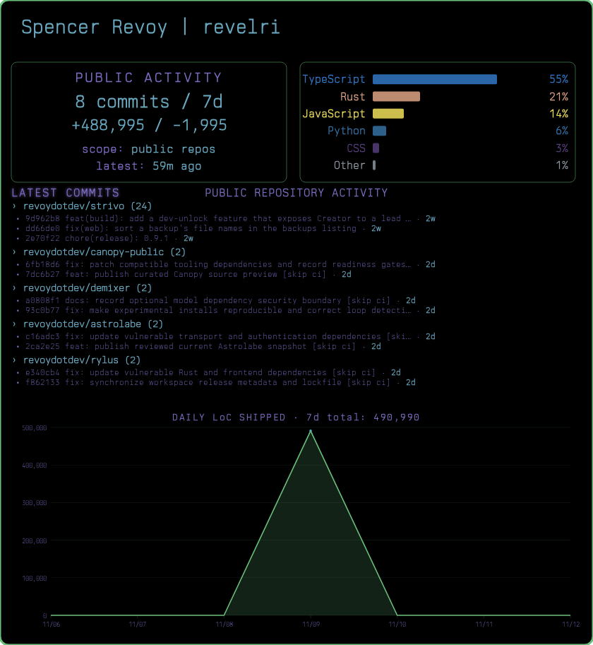

# Spencer Revoy

Software engineer building governed automation, MCP tools, and evidence-oriented systems.
I focus on observable, testable, and recoverable systems, with explicit controls where
automation can affect real systems.

My strongest work spans Python and TypeScript platforms, Rust systems software, Linux operations,
and the control planes around AI agents. Client and organization source stays private; public
repositories are selected proof, not a mirror of every production system.

## Public proof

- [Strivo](https://github.com/revoydotdev/strivo) — alpha cross-platform Rust live-stream PVR,
  daemon, web UI, media pipeline, plugins, and recovery-oriented operations.
- [Rylus](https://github.com/revoydotdev/rylus) — a modular Rust screen and input streaming system modernized from Weylus.
- [mcp-safety-core](https://github.com/revoydotdev/mcp-safety-core) — reusable preview/confirm,
  structured-error, and read-only tool primitives for MCP servers.
- [frontier-mcp](https://github.com/revoydotdev/frontier-mcp) — read-only research tools across
  arXiv, GitHub, and Hugging Face.
- [Demixer](https://github.com/revoydotdev/demixer) and
  [Zeitgeist](https://github.com/revoydotdev/zeitgeist) — an experimental audio pipeline and real-time
  creative visualization.

## Current activity

